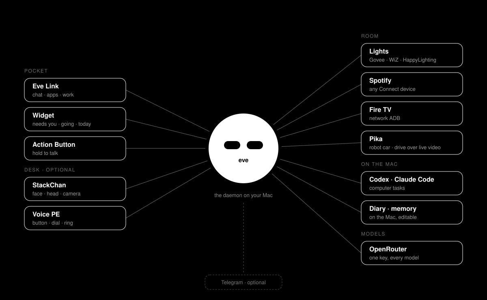

<p align="center">
  
</p>

# eve

**A personal companion across your desk, pocket and room.** You reach eve from
**Eve Link**, its iPhone app: chat, your lights, music and TV, the jobs it is
working on, a home-screen widget, and a voice on the Action Button. On the desk it
can have a face on an M5StackChan and a button and dial on a Home Assistant Voice
PE. It helps with computer tasks, notes, lights, music and the TV, and keeps a diary
of what it notices. Every model call goes through one key, `OPENROUTER_API_KEY`
([OpenRouter](docs/openrouter.md)).

The lights, music, TV, camera and car are the owner's apps, examples rather than a fixed
set: anyone can add their own with `eve-bridge app new <name>`
([adding an app](docs/adding-an-app.md)).

Setting it up for yourself, or having an agent do it: [Get started](#get-started)
is the path, and [AGENTS.md](AGENTS.md) is the same path written for an agent, with a
check after every step and the rules of the repository.

A **Python daemon on your Mac** connects these devices, tools and local stores.
The devices are optional ways to reach and interact with eve: the StackChan gives
it a face, head and camera; the Voice PE gives it desk controls; Eve Link on the
iPhone carries its voice away from the desk. Calls from the Voice PE, Eve Link and
the Mini App use the same chat brain as Telegram. With conversation memory enabled,
wake-word voice and chat also share saved context. The Mac remains the host when you
take the phone out.

**Contents:** [Ethos](#ethos) · [Connected devices](#connected-devices) ·
[What eve does](#what-eve-does) ·
[Get started](#get-started) · [How it works](#how-it-works) ·
[Data and controls](#data-and-controls) · [Repository guide](#repository-guide) ·
[Development](#development) · [Credits](#credits)

Current model allocation and reasoning efforts are listed in the
[model role table](docs/openrouter.md#models-by-role), with the measured comparison
and its limits. Routine chat, extraction and synthesis use Luna; repeated watch
checks use DeepSeek; Think and Think hard retain Sol and Astra.

## Ethos

eve is a personal project about having a useful companion present in everyday
life: something you can talk to, ask for help and carry with you.
Its character, physical controls and ability to act belong together.

- **Continuity across devices.** Changing from the desk button to the
  phone should keep you with the same eve. These call paths share the chat's tools;
  opt-in [conversation memory](docs/stackchan/memory.md) gives voice and text a
  common history, profile and things you asked it to remember.
- **Presence you can read and touch.** Eyes, head movement, the light ring and
  chirps make listening, thinking, working and asking visible. Buttons and a dial
  give you direct control alongside speech. The robot's
  [personality](docs/stackchan/personality.md) adds expression to that interface.
- **Help with getting things done.** Computer tasks, room controls and notes
  sit alongside each other. Multi-step
  [job cards](docs/stackchan/chief.md) state their intended outcome and check
  evidence before calling the work done.
- **Memory you can inspect and correct.** The diary of observations and the record
  of what you said are separate. Conversation memory is off by default; when
  enabled, its files live on the Mac, its records can be edited, and forgetting
  previews what will be removed before asking for confirmation.
- **Control and clear boundaries.** You choose the integrations, can stop a task,
  disable wake-word listening and turn the daemon off. Local storage and local room
  control coexist with cloud model calls, Telegram and Spotify; the
  [data and controls](#data-and-controls) section says what leaves the Mac.

## Connected devices

These are the implemented connections. Each device has its own role and setup;
you can use the Mac and phone features without a StackChan.

| Device or surface | Connection | Role |
|---|---|---|
| **Mac host** | Local daemon, files and IPC | Runs voice, chat, tools, computer tasks and memory. Its microphone captures wake-word conversations and Voice PE button presses. |
| **M5StackChan K151 / CoreS3** | USB serial to the Mac | Face, moving head, camera, captions and chirps. Custom Arduino firmware keeps the body responsive while the Mac handles perception and model calls. [Build guide](docs/stackchan/build.md). |
| **Home Assistant Voice PE** | A second USB serial link as the controller | Button, dial, light ring and spoken replies. Hold to talk through the **Mac microphone**; the Voice PE's microphones are not used. Its dial can control voice volume or Spotify. Runs eve's custom firmware. [Voice PE guide](docs/voice-pe.md). |
| **iPhone with Eve Link** | HTTPS and a secure WebSocket through a tunnel to the Mac | The main way in. Four tabs, and it always opens on Chat: **Updates** (left of Chat: a few cards of things to act on, found in your mail, calendar, notes, memory and the chief's jobs; each is one sentence like "**Review** your storage plan before the new price starts Oct 23", and a tap sends exactly that sentence to Chat; [Updates](docs/updates.md)), **Chat** (eve's replies drawn with [OpenUI](docs/app-chat.md#using-generated-cards), with a text view, local input reset and recovery for incomplete cards, photos and files, and the Claude relay; no `/` menu, you type plain language), **Apps** (Notes, a small native Notion over your second-brain vault; Music, Lights and the TV remote; [Pika](docs/pika.md), hold-to-drive for the robot car over its live video, when set up; [Camera](docs/obsbot.md), the OBSBOT webcam's live picture with hold-to-turn, zoom and tracking; what eve remembers is under Settings, and so is [Share location](docs/phone-location.md), which lets eve answer where you are) and **Work** (the chief's jobs). Voice mode is hold to talk; the Action Button talks from anywhere, with a minimal Live Activity. A large home-screen [widget](docs/widget.md) shows what needs you, what's going, today and now. The phone needs internet and the Mac daemon must remain reachable. Notifications come through the free ntfy app. [App](docs/app-chat.md), [setup and pairing](docs/action-button.md#setting-it-up), [notifications](docs/notifications.md). |
| **Mac app and desktop widget** | Local IPC and shared data snapshots | Chat, diary, photos, saved memories, plus wake-mic and daemon controls. [Widget and app setup](docs/stackchan/widget.md). |
| **Room lights** | Govee and WiZ over LAN; HappyLighting over BLE; Sylvania/Tuya over LAN | Names, rooms, colours, brightness and on/off. Device control stays local after setup; the Mac must be on the same network or within BLE range. [Lights guide](docs/lights.md). |
| **Spotify Connect devices** | Spotify Web API from the Mac | Playback, volume and transfer to the Mac, phone or supported speakers. Voice PE's Spotify mode makes its dial and button the controls; music plays on the selected Connect device. Requires login and [Premium for playback control](https://developer.spotify.com/documentation/web-api/reference/start-a-users-playback). [Spotify guide](docs/spotify.md). |
| **OBSBOT Tiny 3 webcam** | Directly over USB for moving it (UVC through IOKit: a small C helper eve builds with clang); OBSBOT Center's OSC on the Mac for tracking, AI modes, presets and sleep, while it runs; the picture through AVFoundation and ffmpeg | Ask eve ("camera left", "point the camera at the door", "zoom in on me") in the chat, the app or out loud; Eve Link's Apps tab: the live picture, hold-to-turn arrows, zoom and tracking; and `eve-bridge obsbot` from the command line. On while an OBSBOT camera is plugged in. [OBSBOT](docs/obsbot.md). |
| **Pika, the robot car** | The car's camera board on the home Wi-Fi: commands over TCP from the Mac, video over WebRTC from the Mac to the phone (the tunnel stream when WebRTC can't connect) | Eve Link's Apps tab: the car's live video fills the screen, with four arrows and a Stop over it. Hold an arrow to drive; lift it and the car stops. The Mac stops the car too when the phone's beats stop, and connects only while the screen is open. Off unless `EVE_PIKA=1` and `pika.json`. [Pika](docs/pika.md). |
| **Fire TV smart TV** | Network ADB from the Mac (port 5555) | Power, volume and mute, play and pause, the remote's d-pad, apps by name, YouTube search, typing and screenshots. The Mac must be on the same network; ADB Debugging must be on, on the TV. [Fire TV guide](docs/firetv.md). |

Eve Link and Voice PE hold-to-talk run on the chat brain (`TelegramInlet`), so its
setup is still needed. Telegram itself is optional: `EVE_TELEGRAM=app` keeps the
brain for the app, calls, watches and the chief and sends nothing to Telegram; eve's
messages land in the app's chat. A new phone pairs with `eve-bridge link pair`
on the Mac ([pairing](docs/action-button.md#pairing-the-phone)). The Mini App remains an
optional phone interface. The Mac chat window needs that setup and an initial owner
message; its displayed history comes from opt-in conversation memory. Wake-word
listening without a connected board needs `EVE_MIC_ALWAYS=1`. The
[setup steps](#get-started) and device guides cover these dependencies.

## What eve does

### On your desk

- **Listens and responds.** Local wake-word detection starts a voice session. By
  default, replies appear as captions on the robot while it chirps; spoken audio
  through the Mac is optional. The Voice PE's button gives you a separate
  push-to-talk path through the chat brain, with replies on its speaker when it is
  connected as the controller. Web search and a reasoning backend handle questions
  that need more than a quick reply.
- **Sees and moves.** Host-side face detection helps it follow a conversation
  partner, recognise its owner, and remember where they usually sit. It can look
  for an object, explore the room, take a photo on request, or dance.
- **Has moods and a diary.** An on-board affect engine drives expressions, movement,
  LED patterns and chirps. The host keeps observations, selected thoughts and
  photos, a room/person profile, and nightly reflections.
- **Remembers what you said (opt-in).** With `EVE_MEMORY=1`, every word of a
  voice or Telegram conversation is kept on the Mac the moment it is said, both
  channels see each other, and a nightly dream turns each day into editable records
  and a profile. Both brains can `memory_search` it; “remember that” stars a fact;
  “forget that” previews the counts, then removes matches from the conversation
  memory stores on a yes. See [memory](docs/stackchan/memory.md). Memory on or
  off, the Telegram chat keeps a small log of its last messages and of what it
  handed to an agent (`~/.config/eve-bridge/chat/log.json`, 0600, 300 lines
  and 7 days at most), so a quiet spell or a restart does not wipe the chat and
  “before that” is looked up, not guessed; `EVE_CHAT_LOG=0` turns it off
  ([chat log](docs/stackchan/telegram.md#the-chats-history-the-chat-log)).
- **Mirrors Claude Code.** Session hooks and transcript updates make eve sleep,
  work, celebrate, or ask for attention. A tap can focus a waiting terminal;
  Claude Code permission prompts remain in that terminal.
- **Shows its day.** The macOS menu-bar app, diary window and WidgetKit extension
  show thoughts, photos, feelings, what you asked eve to remember, its dream
  journal, with wake-word microphone and daemon power controls.

### On your Mac

- **Does computer tasks.** Voice and text tasks run through Codex Computer Use,
  with progress, permission questions and “stop” relayed through eve. A request
  that is one or two clicks on the window in front ("switch to week view") is
  clicked in about a second before Codex starts ([the desk lane](docs/stackchan/routing.md#clicking-the-front-window-before-codex-the-desk-lane)). See
  [how a task is routed](#how-a-computer-task-is-routed).
- **Takes notes.** `eve-bridge take-notes start` records a room-note session;
  stopping it writes the full transcript, split by voice ("Speaker 1", "Speaker 2"),
  and detailed notes on top: summary, speakers, topics, decisions, actions, open
  questions and checked quotes. See [taking notes](docs/stackchan/voice.md#taking-notes-on-the-room).
- **Controls your lights.** Govee and WiZ (LAN), HappyLighting (Bluetooth) and
  Tuya lights such as Sylvania Smart+ Wi-Fi, with local device commands from the Mac.
  "Lights blue", "lights off" or "dim the bedroom to 30%" is done by code in
  about a second, from Telegram, the Voice PE or the robot's voice, and the Mini App
  has a Lights card (on, off,
  colours, brightness). "Make it cozy" goes to the model. See
  [lights](docs/lights.md).
- **Controls your Spotify.** The same controls as spotKnob, the Spotify dial:
  "pause the music", "next song", "music volume 40", "what's playing", "play the
  music on the kitchen speaker", and "play Daft Punk on Spotify". A message that
  is only one of these is handled by code. Anything more goes to the model,
  which has the Spotify tools. The Mini App has a Music card (art, ⏮ ▶ ⏭,
  volume, and a device list). If nothing is online, eve opens the Mac's
  Spotify. "Spotify mode" turns the Voice PE into the knob: a green ring, the
  dial as volume, 1/2/3 clicks for play-pause/next/previous, hold for a device
  picker, and a 3 s hold to leave. Log in once with
  `eve-bridge spotify login`. See [Spotify](docs/spotify.md).
- **Controls your Fire TV.** Over network ADB from the Mac: "turn on the tv",
  "tv volume 30", "pause the tv", "open youtube on the tv" and "search lofi
  beats on youtube on the tv". A message that is only one of these and names the
  TV is handled by code. Anything more goes to the model, which has the TV
  tools, including the d-pad, typing and a screenshot. The Mini App has a TV
  remote card (power, d-pad, back / home / menu, play-pause and seek, volume,
  and app chips). Pair once with `eve-bridge firetv pair`. See
  [Fire TV](docs/firetv.md).

### From your phone (opt-in)

The [Telegram door](docs/stackchan/telegram.md) is **off by default**. With it on:

- **Chat, start or stop a Mac task,** answer the questions a task asks, and get a
  photo from the robot's camera or a screenshot.
- **`rundown`** summarises today's email, calendar, Slack mentions/DMs and Obsidian
  todos. It only reads. "Plan my day", "what's my plan today", "what's on today"
  and close variants get the same read, ending with a short plan.
- **`new claude`** opens Warp on the Mac with Claude Code (personal) or era-code
  (work) in a folder you pick, with tap buttons. **`claude on`** relays a running
  session to the phone: it picks the only one, offers buttons when there are
  several, and opens a new one when there are none. Sessions whose terminal
  has closed are left out. A 👍 on your text means it was typed (an image
  shows 👀 while it downloads, then 👍), and a
  "Thinking…" bubble shows while Claude works, until its turn ends. Permission prompts have **Allow** and
  **Deny** buttons, and Claude's questions have a button per option. Other text
  you type while a prompt waits still goes to Claude. This holds for app
  consents and Codex approvals too: only a tap or a plain answer ("yes", "no",
  "allow for task") answers them. `claude off` while a prompt waits hands it
  back to the dialog on the Mac.
- **Answers web lookups in seconds.** "What's the weather in Seattle this weekend" or
  "compare the Linear and Jira team plans" doesn't need your browser. Jev spots a
  public-web reading task, and TinyFish (free) reads the top pages so eve can answer
  with their sources. Anything that needs your accounts, your Mac or typing into a site stays on
  your computer. See [routing](docs/stackchan/routing.md#public-web-reading-tasks-go-to-the-web-reader).
- **Watches prices, stocks and ticket releases.** "Tell me when AAPL drops below
  300", "tell me when this is under $80: <link>", "let me know when tickets for X in
  Seattle go on sale", or `/watch VOO below 500`. eve checks on a schedule
  through one rate limiter and texts you when it happens. It reads a page's own
  price data first, then its text, then the page in a headless browser with a
  vision model looking at it. A shop that refuses Python is read again with
  Chrome's TLS handshake (`curl_cffi`). A site that refuses every local reader
  can be read through TinyFish if you give it a key. Bare `/watch` lists the
  watches. See
  [watching](docs/stackchan/watch.md).
- **Rides in your pocket.** Press the iPhone's Action Button, or hold to talk in the
  **Eve Link** app, and eve answers on the phone, even when it is locked. Each
  turn goes to the daemon as a call, and one transcription turn includes your pauses.
  `/stick` in Telegram pairs the app. You can also text eve in the app: replies stream
  in, with tables and charts where they help, and are not posted to Telegram. See
  [the Action Button](docs/action-button.md) and [chat in the app](docs/action-button.md#chat-in-the-app).
  A home-screen widget shows what needs you, what is going, what is left on today's
  calendar and what is playing. See [the widget](docs/widget.md).
- **Suggests what to act on.** The app's **Updates** pane, left of Chat, reads your
  inbox, the coming week's calendar, open to-dos in your notes, what your memory says
  is still open and the chief's jobs, and keeps up to eight one-sentence cards ("Reply",
  "Pay", "Review", "Book"…) with no newsletters, receipts or weather. It only suggests:
  a tap sends the card's visible sentence to the chat, and nothing an email says is
  ever carried out. See [Updates](docs/updates.md).
- **Takes calls from your phone.** **Call eve** in the Mini App is push to talk into
  the same brain you text, so a call can do everything a text can. Replies are spoken,
  not texted, except what you need in writing (links, codes, alerts, screenshots). See
  [calling eve](docs/stackchan/miniapp.md#calling-eve).
- **Sits in on your Google Meet calls.** `/meet <link>`, `/meet 6pm`, "join my
  3pm", or "hey eve, join my meeting": eve joins from your Chrome with the
  microphone and camera off, never speaks, reads the captions, and texts you the
  notes (decisions, actions, open questions) when the call ends. See
  [sitting in on Meet calls](docs/stackchan/meet.md).
- **A `/` menu** of the code words (`/claude_on`, `/new_claude`, `/codex`,
  `/rundown`, `/watch`, `/meet`, `/screenshot`, `/stealth`, `/wake`, `/stop` and more), in your
  chat only.
- **Works like a chief of staff** (in the Telegram chat, on since its capture
  eval passed on 2026-09-29; `EVE_CHIEF=off` turns it off; `/jobs` and `go c12`). Work with more than one step becomes a card: eve
  says back what it intends ("I intend to read 3 or more store pages, pick one,
  then order it after your Go. Up to $1 and 30 min."), runs the steps through
  the web reader, one options call and the Mac, and asks your Go before anything
  consequential actions such as sending, deleting or purchasing (a plain yes or a tap;
  "ok, also …" is a new message, not a yes). A card is done only when checks that read real
  evidence (pages read, text seen on screen, a watch set) say so. A step that
  fails gets one short written lesson for the next try ([Reflexion](https://arxiv.org/abs/2303.11366)).
  After a step that brings news or fails, a [replanner](docs/stackchan/chief.md#replanning) may
  change the read-and-weigh steps still to run, or replace a failed one; it never touches a step
  that needs your Go (`EVE_CHIEF_REPLAN`, in shadow until its blind eval passes).
  Messages it would send on its own wait for a break in your day, stay out of
  22:30-08:00 and are only logged for now. See [chief of staff](docs/stackchan/chief.md).
- **Reads your Canvas.** With a Canvas access token in the env file, "what's due
  this week", "any announcements in 447?" or "send me the HW3 link" is answered
  from your school's Canvas, times in your time zone, and `rundown` lists what is
  due in the next three days. Read only: it cannot submit or post. See
  [Canvas](docs/stackchan/canvas.md).
- **Keeps your personal notes.** With the [second brain](docs/stackchan/second-brain.md)
  on, a text saves a note, updates a list, checks off a todo, or undoes an edit in
  your Markdown vault. A saved note gets a ✍ on your message instead of a reply,
  and a fact you ask it to remember gets a 🏆.
- **Shops through AgentCard.** Opt in with your user-scoped AgentCard token to
  find available merchants, build a cart and check order status from chat or a
  desk or phone call. Eve shows the selected cart's items, quantities,
  fees, tip and total, then waits for your explicit approval before submitting
  that exact cart to AgentCard Vault. A timeout requires a status check, with
  no automatic purchase retry. See [AgentCard setup and limits](docs/agentcard.md).
- **Finds official U.S. legal and government sources.**
  `EVE_AMERICA=1` adds `/america` to the owner menu and a question/jurisdiction
  tool to the shared chat/call brain. Alexandria's government index is the default:
  one index lookup and up to three deduplicated official page reads supply the
  sources for Eve's cited response. Timestamps do not establish current law.
  America.gov browser/API chat remains an explicit experimental option.
  See the [contract, setup and limits](docs/america.md).
- **Finds restaurants and available tables.** `EVE_OPENTABLE=1` adds
  `/opentable` and an OpenTable search tool to the shared chat/call brain while
  computer control is enabled. Eve uses your signed-in Chrome session to check
  the visible OpenTable page and returns observed times and restaurant links.
  `/opentable Seattle tomorrow at 7 pm for 2 people` starts a search;
  `/opentable cancel` stops it. Search does not hold or submit a reservation.
  This is a best-effort browser integration; see [setup and limits](docs/opentable.md).
- **Shares your files with people.** `EVE_SHARE=1`: "send the report to
  Ana" goes by iMessage from this Mac, or by email as a Google Drive link, after
  you tap Allow on the file and the recipient ("send me the report" still comes
  to you in the chat). See [file sharing](docs/share.md).
- **Starts each chat turn with the tools it needs.** The message's words plus
  Jev's judgment of it pick which of your apps, file sharing and Slack,
  Notion and Linear a turn starts with, so most turns need no extra round to
  load them (`EVE_TOOLSET_ROUTER`; `off` keeps the turn as it was). See
  [toolset router](docs/toolset-router.md).
- **Asks before consequential actions.** Routine reads, notes, lights, music,
  local app edits and ordinary computer tasks proceed without another check.
  Sending, deleting, purchasing, publishing and permission changes get a
  concrete approval at the action boundary. Reading outside text keeps its
  provenance marks but no longer adds a question to every later routine action.
  See [confirmation rules](docs/stackchan/telegram.md).
- **The `/` menu in plain words, and events from Ticketmaster.** Behind
  `EVE_MENU_TOOLS` (off until its blind eval passes): "what did you spend
  today", "go quiet for a while", "any concerts in Seattle this weekend",
  "book dinner for 4 fri at 7", "what does the notes file on my desktop say"
  (`read_file`). See [events](docs/events.md).

### Experimental

- **Live expressions.** eve picks one of eleven temporary eye expressions,
  including a wink, from conversation and diary text, even while speaking. Jev
  (TypeSafe's typed-decision model, one `choice` per turn, ~200 ms) picks by default;
  `EVE_EXPRESSION_BACKEND=laya` keeps the original local Laya checkpoint, which
  scored 15–20 points lower on the hand-written cases. Eve Link's voice-mode face
  draws the cues during a phone call (on unless `EVE_PHONE_EXPRESSIONS=0`;
  [voice mode](docs/voice-mode.md#expressions)); the retired board rendered them too.
  The picker controls the eyes only. See [controls, limits and measurements](docs/stackchan/laya-expressions/README.md)
  and the [expression-tuning study](docs/stackchan/laya-emotion/README.md).

## Get started

eve runs on a Mac and is used from an iPhone. The whole setup is about an hour;
every step below ends with a check, because what goes wrong in this project goes
wrong silently. If an agent (Claude Code, Codex) is doing the setup for you, point it
at [AGENTS.md](AGENTS.md): the same steps with the checks and the house rules.

### 1. The Mac

You need macOS 14 or later, Python 3.12, Homebrew, and these keys in
`~/.config/eve-bridge/env` (mode 600, one `KEY=VALUE` per line):

| Key | Where it comes from |
|---|---|
| `OPENROUTER_API_KEY` | [openrouter.ai](https://openrouter.ai). Every model call eve makes goes through this one key ([one key: OpenRouter](docs/openrouter.md)). |
| `EVE_TELEGRAM_TOKEN`, `EVE_TELEGRAM_OWNER` | A bot token from **@BotFather** (`/newbot`) and your numeric user id from **@userinfobot**. eve's brain is wired through its Telegram door even when Telegram is muted; with `EVE_TELEGRAM=app` nothing is ever sent there. `EVE_TELEGRAM=1` also answers on Telegram. |

```bash
git clone https://github.com/gurul/eve && cd eve
python3.12 -m venv bridge/.venv
bridge/.venv/bin/python -m pip install -e './bridge[dev,miniapp]'
brew install cloudflared qrencode               # the phone's tunnel, and pairing by QR code
mkdir -p ~/.config/eve-bridge && touch ~/.config/eve-bridge/env && chmod 600 ~/.config/eve-bridge/env
```

```dotenv
# ~/.config/eve-bridge/env
OPENROUTER_API_KEY=...
EVE_TELEGRAM=app
EVE_TELEGRAM_TOKEN=...
EVE_TELEGRAM_OWNER=123456789
EVE_MINIAPP=1          # the phone's door (a Cloudflare quick tunnel)
EVE_MEMORY=1           # transcripts and the nightly dream; off in code
EVE_SHARE=1            # send your files to people by iMessage or email, on your yes
```

Install the Claude Code hooks and the login service (both commands; `--service`
installs only the service):

```bash
bridge/.venv/bin/eve-bridge install
bridge/.venv/bin/eve-bridge install --service --serial-port '/dev/cu.usbmodem*'
```

In **System Settings → Privacy & Security**, give the venv's Python (the exact
binary `eve-bridge ears-check` prints) **Microphone**, **Accessibility** and
**Screen Recording**. macOS grants these to the interpreter, not to a terminal.

**Check:** `bridge/.venv/bin/eve-bridge status` lists the hooks and
`Service (launchd): loaded`; `tail -40 ~/Library/Logs/eve-bridge.log` shows a
`code: … @ <commit>` line and `miniapp: live at https://….trycloudflare.com`.
After any change to the env file:
`launchctl kickstart -k gui/$(id -u)/com.github.eve-bridge.daemon`.

### 2. The iPhone

Eve Link needs Xcode 26 and `brew install xcodegen`. The project is signed with
the owner's team (`DEVELOPMENT_TEAM` in `ios/EveLink/project.yml`); set your own
team id there for both targets. A free Apple ID works, with a reinstall every 7 days.

```bash
sh ios/EveLink/build.sh --install            # Node 22.12+, pnpm; phone unlocked, same network or a cable
bridge/.venv/bin/eve-bridge link pair     # prints the pairing link and a QR code
```

Scan the code with the iPhone's camera and tap **Open in Eve Link**. The link
holds the pairing token, so it is for your phone only. Open the app, go to voice
mode (top right) and allow the microphone. Then **Settings → Action Button →
Controls → Eve Link → Talk to eve**, and keep Live Activities on for Eve
Link ([the Action Button](docs/action-button.md), [voice mode](docs/voice-mode.md)).

For notifications, install **ntfy** from the App Store, run
`eve-bridge notify topic`, subscribe to that topic in ntfy, then
`eve-bridge notify test` ([notifications](docs/notifications.md)).

**Check:** type "hi" in the app and get an answer; in voice mode, press the Action
Button and ask the time. eve's face looks at you, your words show under it, and
the reply plays with captions.

### 3. Your apps and your devices (optional)

- **Gmail, Calendar, Drive, Contacts:** `EVE_APPS=1`, a Google Cloud OAuth
  client saved as `~/.config/eve-bridge/google-oauth-client.json`, then
  `eve-bridge apps login google` ([connected accounts](docs/apps.md#set-it-up)). Gmail
  sends only after your yes on the whole email; routine private calendar and Drive edits run; consequential changes ask;
  Contacts only looks.
- **GitHub and Maps:** `EVE_GITHUB_MCP_TOKEN` and `EVE_GOOGLE_MAPS_KEY`
  in the env file. eve learns your repositories so "my car repo" is found.
- **Slack, Notion, Linear:** through Composio, `EVE_COMPOSIO=1` and
  `COMPOSIO_API_KEY` ([the apps](docs/stackchan/telegram.md#the-apps-composio)).
- **Lights, Spotify, Fire TV:** [lights](docs/lights.md#set-up),
  [Spotify](docs/spotify.md#setup-log-in-once), [Fire TV](docs/firetv.md#setup-on-the-tv).
  Each is on as soon as its one-time setup has run.
- **Pika, the robot car:** `EVE_PIKA=1` and `~/.config/eve-bridge/pika.json`
  ([Pika](docs/pika.md#setting-it-up)).
- **The OBSBOT webcam:** plug it in and run `eve-bridge obsbot setup` (needs Apple's command line tools); OBSBOT
  Center only for tracking and the AI modes ([OBSBOT](docs/obsbot.md#set-up)).
- **A face on the desk:** the M5StackChan robot ([build](docs/stackchan/build.md),
  [voice](docs/stackchan/voice.md); the wake-word voice is the one feature that still
  needs `OPENAI_API_KEY`) and the Home Assistant Voice PE controller
  ([Voice PE](docs/voice-pe.md), `EVE_CONTROLLER_SERIAL=<its USB serial>`).
- **The Mac menu-bar app and widget:** [widget](docs/stackchan/widget.md).

<details>
<summary><b>Troubleshooting</b></summary>

- **The phone says "Pair Eve Link first":** run `eve-bridge link pair` again
  and open the new link on the phone.
- **A call connects but eve never answers:** `grep -E "but off|OPENROUTER" ~/Library/Logs/eve-bridge.log`;
  the brain needs the bot token, the owner id and the OpenRouter key.
- **A Google app answers HTTP 403 "has not been used in project":** enable that API in
  your Cloud project (Gmail, Calendar, Drive, People) and wait a minute.
- **`build.sh --install` fails with CoreDeviceError 4016:** the phone is locked.
- **Wakes but stalls:** [voice troubleshooting](docs/stackchan/voice.md#when-eve-hears-you-and-then-sits-still).
- **Sees camera frames but stops following faces:** [face tracking](docs/stackchan/vision.md#following-whoever-is-talking).
- **Noise between chirps on the robot:** reflash; the [build guide](docs/stackchan/build.md)
  has the timed isolation tests.
- Every silent failure met on a clean machine, with its evidence: [SETUP-ISSUES.md](docs/SETUP-ISSUES.md).

</details>

## How it works

The Mac is the hub. Device firmware handles the face, movement, buttons and audio;
the daemon coordinates calls, tools, computer tasks and memory. The
iPhone reaches that same daemon through Eve Link, rather than running a model
on the phone. Wake-word voice has its own live voice backend; desk and phone calls
send transcribed presses to the chat brain.

<p align="center">
  
</p>

| Component | Implementation and responsibility |
|---|---|
| Robot firmware | Arduino C++ on ESP32-S3; M5StackChan BSP and M5Unified for hardware, RoboEyes for the face. Local state machines handle gaze, affect, conversation phases, motion and synthesised chirps. |
| Voice PE controller | `firmware/eve_voice_pe/` handles the button, encoder, ring and serial PCM playback. `controller.py` keeps a separate controller link; `desk_call.py` records the Mac mic and adapts button presses to the shared call path. |
| Phone link | `ios/EveLink/` records the phone's microphone and plays eve's reply, as 24 kHz PCM over a WebSocket. `stick_link.py` authenticates the phone's WebSocket and adapts it to `phone_call.py`. |
| Host bridge | Python with `asyncio`; `eve-bridge` is the CLI and daemon entry point. Hooks and CLI commands use local JSON IPC; the robot link is newline-delimited JSON over USB serial. |
| Voice and reasoning | sherpa-onnx keyword spotting with sounddevice audio input; the configured defaults are `gpt-live-1` for wake-word voice, `gpt-6-astra` for its tool backend, `gpt-6-luna` for Telegram text and the shared call brain, and `gpt-6-astra` for deep reasoning (`think_hard`). Captions are the default wake-word output; calls produce spoken replies. Voice, text and deep reasoning search the web through Jev, which routes each search: a settled one-fact or one-page lookup to TinyFish (free), live fares and official records to Firecrawl's data tools, and everything else to Perplexity through OpenRouter, which also takes any search the others fail (`search_router.py`; [search routing](docs/stackchan/routing.md#web-searches-go-to-the-provider-that-fits)). Without an OpenRouter key it is OpenAI's built-in search. eve's prompts carry a short live summary of its own models and providers (`self_context.py`), so it answers questions about its setup from the running code, not from memory. |
| Desktop control | The voice and text `start_task` tool delegates to Codex app-server and its installed `cua_repl.js` Computer Use plugin. Progress, explicit permissions, results, steering and cancellation return through eve. `EVE_DECISIONS=1` optionally adds an image-aware, bounded click-and-verify loop after the keyword desk lane declines; [setup, live trial and limits](docs/decisions-computer-use.md), [protocol evaluation and graphs](docs/computer-protocol-evaluation.md). |
| Room controls | `lights.py` talks directly to supported lights over LAN or BLE; `spotify.py` uses Spotify's Web API; `firetv.py` runs Google's `adb` against the TV over the LAN; `pika.py` drives the robot car over its camera board's TCP relay with timed moves (the car stops by itself within 450 ms of the last one), and `pika_rtc.py` (aiortc) sends its video to the phone over a WebRTC data channel, each JPEG as the camera made it. Exact light, music and TV commands have code paths that avoid a model turn. |
| Purchasing | Optional `agentcard.py` uses AgentCard's conversation Purchase API and Vault. `agentcard_tools.py` binds each confirmation to an owner-approved cart; a private journal prevents blind resubmission after errors or restarts. [Setup](docs/agentcard.md). |
| Government and legal information | Optional `/america` asks for a question, or accepts `/america <question>` including jurisdiction. Default Alexandria government-index retrieval returns official source excerpts and bounded page text; the existing shared chat/call brain writes a cited response. One index call, up to three unique page reads, shared Firecrawl daily cap and explicit freshness uncertainty. America.gov browser/API chat is legacy opt-in. [Contract and setup](docs/america.md). |
| Restaurant availability | Optional `/opentable <request>` and shared chat/call `opentable_search` check live OpenTable pages through Codex Computer Use and signed-in Chrome. Returns observed times and links, with no reservation hold or submission. [Setup and limits](docs/opentable.md). |
| Vision and memory | macOS Vision for face detection, host-side identity/following logic, model-assisted scene observations and reflections, plus a separate conversation memory: transcripts, records rewritten by a nightly dream (`records.py`), and a mem0 index. |
| Native UI | SwiftUI menu-bar app and diary window, with a WidgetKit extension. The helper mirrors local data into an App Group snapshot for the widget. |
| Memory integrations | In-process publish/subscribe bus; optional rosbridge-compatible WebSocket endpoint and claude-mem sink/recall. Neither is required. |

### How a computer task is routed

`start_task(goal)` creates a fresh, ephemeral Codex session through
`codex_computer.py`, after checking that `cua_repl.js` is installed and enabled.
Codex drives native apps through its `cua` API while eve relays progress and
permission choices.

- **Web lookups go to the web reader first (with `TINYFISH_API_KEY`):** Jev
  (`browser_router.py`) sends a task there only when the whole job is reading public
  websites: no accounts, nothing on the Mac, nothing to show on screen, nothing typed
  into a site. TinyFish searches and reads the top three pages, free, and a cheap model
  answers from them with their links, in seconds. Anything it can't answer, and every other task, goes to Codex. Blind-tested: 30 of 30 routed correctly, 0 unsafe. See
  [routing](docs/stackchan/routing.md#public-web-reading-tasks-go-to-the-web-reader).
- **Your own Chrome first (opt-in):** with `EVE_BROWSER_ATTACH=1`, web goals try
  your logged-in Chrome first. Chrome's “Allow remote debugging?” prompt is answered
  from your phone (a no or silence cancels), or pressed by eve with no question when
  `EVE_CHROME_ACCESS=allow`. eve works in its own tab, and anything
  unfinished goes to Codex. See [attach mode](docs/stackchan/routing.md#controlling-your-logged-in-chrome-attach-mode).
- **Or eve's own Chrome (opt-in):** with `EVE_BROWSER_OWN=1`, web goals run in
  a second Chrome that belongs to eve (`~/.config/eve-bridge/chrome`), so there
  is no “Allow remote debugging?” prompt at all. Sign it in once with
  `eve-bridge chrome-profile`. See [eve's own Chrome](docs/stackchan/routing.md#eves-own-chrome-no-allow-to-press).
- **Stopping:** `stop_task` interrupts Codex, even while a permission is pending.
- **Codex billing:** `EVE_CODEX_AUTH=plan` is the default and uses your existing
  Codex sign-in. To bill Eve's Codex to an OpenAI API key instead (optional; nothing
  else in eve uses that key), put `OPENAI_API_KEY` in Eve's env file, run `eve-bridge codex-home`, then set
  `EVE_CODEX_AUTH=api` for a future daemon start. This prepares a private
  `~/.config/eve-bridge/codex-home` for computer tasks, Codex chat and warm
  agents; your own Codex sign-in stays untouched. Missing API setup falls back to
  the plan with one warning. API spend uses reported token counts when available.
  See [setup and compatibility](docs/codex-computer-use/README.md#separate-api-key-billing).
- **Permissions:** routine app access, HTTP(S) site access and downloads proceed
  automatically in chat and call tasks. Agents ask before purchases, deletions,
  and sends/publication/uploads outside Telegram. Only uploads to the exact
  `https://web.telegram.org` origin inherit the Telegram exception. Set
  `EVE_CODEX_ROUTINE_ACCESS=ask` to restore access questions;
  `EVE_CODEX_SITE_ACCESS` separately overrides site access (`ask` or `allow`).
  Unknown permissions, raw browser access, sign-in handoffs and mandatory security
  checks still ask or remain blocked. Explicit app prompts offer native persistence
  choices when Codex permits them; Eve's automatic grants do not save permissions.
- **Pictures:** browser tasks return a capture of their own tab. A missing capture is
  reported rather than replaced with an unrelated desktop screenshot.
- **Limits:** a read-only filesystem sandbox, approvals on request, and a ten-minute
  task budget. `EVE_CODEX_BIN` selects a Codex executable (default: the desktop
  app's bundled one). There is no fallback if Codex is unavailable.

See [integration evidence and limits](docs/codex-computer-use/README.md).

<details>
<summary><b>The legacy worker</b> (<code>computer_agent.py</code>, kept but no longer selected)</summary>

1. **Code shortcuts** handle recognised app launches and web searches (`task_router.py`).
2. **Accessibility routing** handles requests fully described by a labelled UI control
   (`lane_router.py` over `fast_lane.py` and `ax_candidates.py`).
3. **Plan once, execute with Jev** (`EVE_PLAN_EXEC=1`): the planner makes one typed
   plan (`plan_contract.py`) and `plan_executor.py` walks it, grounding each click on a
   fresh Accessibility snapshot with the keyword gate and hosted Jev
   (`typed_ask.ask_jev_step`). Consequential steps stop and ask you; a plan cannot
   approve them.
4. **The planner** handles remaining work turn by turn with screenshots and Python
   desktop helpers, and catches any plan that cannot be made or finished.

Tiers 1–2 are on by default in that worker. Tier 3 and the planner-delegated fast lane
(`fast_lane.py`, keyword-decided; its `model` mode asks `decider.py` over hosted Jev) are
**off by default**. The fast lane's local Laya decider was removed on 2026-09-24; Laya
now drives only the eye expressions (the `[laya]` extra). **Hosted Jev** can also
drive narrowly scoped launch routing and spoken head moves. Clicks use accurate OCR
directly, and a finished screen wait is reused for the reply screenshot. The
**browser lane** (`browser_lane.py`) drives your own Chrome with Playwright in attach
mode (`EVE_BROWSER_ATTACH=1`), or eve's own Chrome with no Allow prompt
(`EVE_BROWSER_OWN=1`). The browser planner now defaults to `gpt-6-luna`;
`EVE_BROWSER_MODEL` overrides it, and explicit agent-model choices are retained.
Observed link URLs support exact destination verification; truncated control lists
stop before a click. See [swarm improvements and before/after graphs](docs/computer-swarm-improvements.md)
for the 54-task rerun (42 → 53 autonomous completions), guarded admission and
the remaining desktop capture limits.

See [routing](docs/stackchan/routing.md) for switches and measured evaluations, and
[voice and computer control](docs/stackchan/voice.md) for worker details.

Twenty state machines are **formally verified in Lean 4** (`verification/`, 286
theorems): the Bash allow tier, the Telegram question slot and Stop, forget against the
nightly dream, the serial link to the robot, the voice turn state, eight for the
watcher (its rate limiter, conditions, scheduler and reading ladder, connection safety,
links, routing and Ticketmaster), four for the Voice PE controller, the OpenAI stream
retry, and the chief of staff's cards (done needs evidence, one yes per
act, the budget, quiet hours and the push budget, no act run again after a restart). Each
is either a kernel-checked counterexample on the old code plus a proof for every trace of
the fix, or a proof of the code as it stands. The chief's model is also replayed against
its Python on generated traces. See [formal verification](docs/verification.md).

</details>

### The Telegram door

`telegram.py` long-polls the Telegram Bot API over outbound HTTPS, so there is no open
port. It needs a switch, a bot token and one allowlisted numeric owner id together.
Every message is shaped for the phone by `telegram_format.py`.

| Feature | What it does |
|---|---|
| Chat and tasks | Chat with eve, start and stop a Mac task, answer a task's question, receive a camera photo. A task shows one progress message with a Stop button; the result arrives as a reply to your request. |
| Images | Send photos or image files with captions (still JPEG/PNG/WebP/GIF, up to 10 MB). See [image routing and retention](docs/stackchan/telegram.md#receiving-images). |
| `rundown` | Today's email, calendar, Slack and Obsidian todos through the packaged [rundown skill](bridge/src/eve_bridge/skills/rundown/SKILL.md). Read-only; names disconnected sources, never result limits. |
| `claude on` | Streams Claude Code's visible text to the phone (never the gray tool lines or thinking) and types your replies in; tool calls run as in bypass mode. Jev judges each relayed shell command for risk (shadow by default). |
| Buttons | Yes/no prompts (Claude permissions, app actions, Codex approvals), Claude's question options and the pickers are inline buttons. A tap does what typing would; typing still works. |
| `codex on` / `codex <folder>` | Starts a new Codex chat in a saved folder, with approvals relayed to Telegram. Each turn shows one progress message with a Stop button. `stop` interrupts, `codex off` returns to eve, `eve:` addresses eve directly. |
| `new claude` | Opens a coding session in Warp from a few short texts. |
| Memory (`EVE_MEMORY=1`) | One memory for both channels ([memory.md](docs/stackchan/memory.md)): every line kept in a local per-day transcript, records and a profile rewritten by a nightly dream, and a self-hosted mem0 index (`EVE_MEM0=0` turns just that off). Tools: `memory_search`, `memory_read`, `forget_preview`, `forget_apply`. |
| Your apps (`EVE_APPS=1`) | Gmail (reads; sends after your yes to each email, shown whole), Google Calendar (writable: events, invites, free time), Google Drive, Google Contacts (read only), GitHub and Google Maps, directly: Google's own APIs and GitHub's and Maps' MCP servers, no broker. Known routine private edits run; sending, deleting, publishing and permission changes ask first. Unknown writes still ask. Apps load per turn as the message names them. Set up with `eve-bridge apps login google`; see [connected accounts](docs/apps.md). |
| Composio (`EVE_COMPOSIO=1`) | Slack, Notion, Linear and the long tail by API (`composio_tools.py`), each change asked first. |
| Camera (`EVE_OBSBOT`, on by default) | The OBSBOT webcam: the chat's and the voice's `camera_status` and `camera_control`, Eve Link's Camera screen and `eve-bridge obsbot`. Moves go over USB; OBSBOT's own features through OBSBOT Center while it runs. On while an OBSBOT camera is plugged in (or OBSBOT Center is installed); `EVE_OBSBOT=0` turns it off. See [OBSBOT](docs/obsbot.md). |
| Phone location (`EVE_PHONE_LOCATION`, on by default) | Eve Link shares the iPhone's latest location with the Mac (`POST /api/link/location`, only the newest fix kept, never logged), so the chat's and the voice's `phone_location` answers "where am I" and quick answers' weather uses where you are. See [phone location](docs/phone-location.md). |
| Ask science (`EVE_SCIENCE_SEARCH`, on by default) | "What does the research say about...": the chat's and the voice's `science_search` searches about 200 million scholarly papers (OpenAlex titles and abstracts, by meaning or exact words) through ScienceMadeReadable's free, keyless public API, and answers citing each paper's title, year and link. Results are outside text for the confirmation rules; the query is never logged. See [Ask science](docs/science-search.md). |
| Pika (`EVE_PIKA=1`) | The robot car in Eve Link's Apps tab: live video and hold-to-drive through this Mac, with `~/.config/eve-bridge/pika.json`. The video comes over WebRTC straight from the Mac (on the home Wi-Fi, past the tunnel), with the tunnel stream as the fallback; `"rtc": false` keeps it on the tunnel. Off by default. See [Pika](docs/pika.md). |
| Updates (`EVE_UPDATES`, on by default) | Eve Link's Updates pane: up to 8 cards of things to act on, made in the background from Gmail, the calendar, the vault's to-dos, the dream journal and the chief's jobs, every `EVE_UPDATES_EVERY_MIN` (120) minutes in day time. Suggestions only; a tap sends the card's sentence to the chat. `EVE_UPDATES=0` turns it off. See [Updates](docs/updates.md). |
| Second brain (`EVE_SECOND_BRAIN=1`) | Texts become notes in a local markdown vault Obsidian opens (`second_brain.py`). |
| Spending | Every paid call eve makes is recorded as it happens: chat, voice (Live minutes and backend calls), thinking, search, Jev, browser and Mac tasks, app builds, memory, camera and room notes. Each is priced at the provider's published rate, or at the cost the provider reports; a model with no rate is recorded without a price, never guessed. `/spend` answers today, yesterday and this month by code; the Mini App header's "$X spent today" opens a Spending view with a 30-day chart and each provider's own figure (OpenRouter always; OpenAI and Anthropic with an admin key). Codex on the ChatGPT plan is counted, not priced. See [what eve spends](docs/stackchan/spending.md). |
| Apps (`EVE_MINIAPP=1`) | "Make me a habit tracker" builds a small app with `claude-opus-5-5` that opens inside Telegram and saves its data on the Mac. Each build is used in a headless phone-sized browser, then Jev walks the 2 to 4 journeys Claude wrote for the app (tap this, type that) and judges whether the screen shows what it should; what broke goes back to Claude to fix (up to 2 rounds). Claude writes and repairs, Jev verifies, and a Jev outage never blocks a build. The app then arrives as a picture (the last screen of a journey that passed) with an Open button. Apps can be changed, undone (10 versions kept), renamed, deleted (to a trash folder) and restored from the chat or the Apps tab. Each app has its own change chat (its ✎ pencil, Telegram's Settings item, or the Change button eve sends) showing what was asked of it and how each build went, where you type the next change. Each app runs sandboxed with a key to its own data only. Open it from the pinned message or `/apps`; the menu button stays the `/` commands. Owner-only (signed `initData`), spend tracked per day with no cap unless `EVE_MINIAPP_DAILY_USD` is set, through a Cloudflare quick tunnel. See [the Mini App](docs/stackchan/miniapp.md). |

eve also gets a local clock snapshot and your configured location and timezone
([voice settings](docs/stackchan/voice.md#knobs)). Full guide:
[text eve through Telegram](docs/stackchan/telegram.md).

## Data and controls

Wake-word detection runs locally. Live voice, push-to-talk calls, reasoning
and scene analysis use the configured model providers, and the relevant audio, text,
or camera frames are sent for those requests. Computer tasks send
screenshots. Local storage does not make those features offline. With the Telegram
door on, your texts and eve's replies also pass through Telegram's servers.
Mini App and Eve Link calls reach the Mac through an HTTPS/WebSocket tunnel, and
the daemon sends their audio to the transcription provider.
With conversation memory enabled, nightly reconciliation and the meaning index
also use configured model and embedding providers.
Light commands use local LAN or BLE protocols; Spotify controls go to Spotify's
Web API. Fire TV commands go from the Mac to the TV over the LAN, and the log keeps
only the action and its outcome, never typed text or a search. With AgentCard enabled, shopping requests and the configured delivery
address go to AgentCard and its merchant integrations. Eve projects the API's
results into cart and order fields; the shopping conversation and those summaries
also reach the chat model and, with memory enabled, its transcripts. AgentCard
tool results exclude payment-card metadata and redact private address text from
provider prose while preserving structured identifiers.
See [purchase data and approval boundaries](docs/agentcard.md#data-and-approvals).
With `EVE_AMERICA=1`, the explicit legal/government question and jurisdiction
go to Alexandria's government index through the existing Firecrawl credential.
Up to three official pages are read without sharing that credential or chat
context; retrieved text passes through the existing chat/call model and normal
conversation handling. Provider caching/retention still applies. Only explicit
`browser`/`api` mode sends the question to America.gov; browser control recovery
uses Jev labels/roles rather than legal prose.
See [government-source data and limits](docs/america.md#data-and-provider-terms).
With a TinyFish key, a computer task's text goes to Jev (TypeSafe's model,
through TypeSafe or OpenRouter) to choose where it runs,
and a public-web lookup's text goes to TinyFish as a search. The watcher sends only the page you asked it to watch.

Persistent data lives under `~/.config/eve-bridge/`:

| Location | Contents |
|---|---|
| `env` | API credentials and runtime settings |
| `notes/` | Diary Markdown, observation JSONL, profiles, highlights and photo records |
| `memory/` | With `EVE_MEMORY=1`: `transcripts/` (every word, and meeting notes), `records/` (profile, stars, records and the dream journal, a sealed local git repository), `mem0/` (the meaning index) and `archive/` (the retired debrief store, moved once). See [memory.md](docs/stackchan/memory.md). |
| `agent-runs/` | Desktop-task run logs |
| `lights.json` | Your lights: names, rooms, local addresses and Tuya keys (mode 600). See [lights](docs/lights.md). |
| `spotify.json` | The Spotify login: the app's client id and the refresh token (mode 600). See [Spotify](docs/spotify.md). |
| `firetv.json` | The paired Fire TV: its address, port, mDNS name and model (mode 600). See [Fire TV](docs/firetv.md). |
| `agentcard/` | Private purchase attempt journal: conversation references and cart identities/outcomes for duplicate prevention and reconciliation. No access token, delivery address or raw payment-card response. The optional address JSON is a separate private file. See [AgentCard](docs/agentcard.md). |
| `chief/` | The chief of staff's cards (each job's title, steps and checks as eve summarised them, with a pointer to where you said it rather than your words), their event and attention logs (ids, numbers and short code words), and the lessons from failed steps. Mode 600. See [chief of staff](docs/stackchan/chief.md). |
| `spend/` | The daily spend ledger (one JSONL file per local day: provider, model, feature, dollars, token counts, never words) and `providers.json`, the providers' own figures. See [what eve spends](docs/stackchan/spending.md). |

- `eve-bridge mic off` stops wake-word microphone capture until re-enabled.
  Voice PE push-to-talk separately opens the Mac microphone while its button is held.
- With the login service installed, the menu-bar app and desktop widget have a
  persistent **Turn eve off / on** control.
- `EVE_ROSBRIDGE=1` exposes memory events at `ws://127.0.0.1:9090` (no
  authentication, loopback by default); `EVE_CLAUDE_MEM=1` saves them to a local
  claude-mem worker. Both are off by default. The event bus carries nothing said in
  a conversation.
  See [memory-bus.md](docs/memory-bus.md).

## Repository guide

| Path | What is here | Documentation |
|---|---|---|
| `firmware/claude_pet_stackchan/` | Active StackChan firmware and C++ host tests | [Build and protocol](docs/stackchan/build.md), [design](DESIGN.md) |
| `firmware/eve_voice_pe/` | Voice PE button, dial, ring and speaker firmware | [Voice PE build and controller setup](docs/voice-pe.md) |
| `bridge/src/eve_bridge/` | Daemon, CLI, voice, desktop control, vision and memory | [Bridge reference](bridge/README.md), [voice](docs/stackchan/voice.md), [routing](docs/stackchan/routing.md), [Telegram](docs/stackchan/telegram.md) |
| `bridge/tests/`, `bridge/tools/` | Python tests, fixtures and routing/desktop evaluation tools | [Routing evaluations](docs/stackchan/routing.md) |
| `widget/` | SwiftUI app, shared data readers, WidgetKit extension and Xcode project | [Widget setup](docs/stackchan/widget.md) |
| `ios/EveLink/` | The Eve Link iPhone app: Updates (things to act on), chat with eve (with photos and files attached), the chief's jobs, Notes (your vault: pages, to-dos, edit, move, delete with undo), native Music, Lights and TV remote controls, Memory and Share location in Settings, voice mode (StackChan's face with captions, the Action Button talks), notes on the go | [Action Button](docs/action-button.md), [Chat in the app](docs/app-chat.md), [Updates](docs/updates.md), [voice mode](docs/voice-mode.md), [phone location](docs/phone-location.md) |
| `verification/` | Lean 4 models of eve's state machines, 470 kernel-checked theorems | [Verification](docs/verification.md) |
| `AGENTS.md` | The setup runbook and the rules, for an agent working on eve | |
| `tools/` | Firmware flashing and demo utilities | [Build](docs/stackchan/build.md) |
| `docs/stackchan/` | Hardware notes, personality, vision and integration details | [Personality](docs/stackchan/personality.md), [vision](docs/stackchan/vision.md), [memory](docs/stackchan/memory.md), [Claude Code](docs/stackchan/claude-code-integration.md) |
| `past-experiments/` | Earlier boards, e-ink firmware and enclosure experiments | [Archive overview](past-experiments/README.md) |

## Development

Install the Python development tools and run the bridge checks from the repository root:

```bash
bridge/.venv/bin/python -m pip install -e './bridge[dev]'
(cd bridge && .venv/bin/pytest -q -n 8 --dist loadgroup)     # ~2.5 min on 8 workers; ~13 min without -n
(cd bridge && .venv/bin/ruff check src/ tests/)
```

- **Live tests.** A plain run never touches this Mac's real services. Tests marked
  `live` write to the real claude-mem worker or launch a real Chromium, so they run only
  when asked: `(cd bridge && EVE_LIVE=1 .venv/bin/pytest -q -m live)`.
- **Routing evals.** These call Jev, which receives the request text, and print their
  ship decision: `(cd bridge && .venv/bin/python tools/route_eval.py [--quit | --browser | --model jev --native])`.
- **Firmware.** Host tests live in `firmware/claude_pet_stackchan/host/`; the
  [build guide](docs/stackchan/build.md) covers hardware setup and bench conventions.
- **Widget file reads.** `sh widget/Tests/run.sh` checks the Foundation-only readers;
  `sh widget/Tests/benchmark.sh` measures a synthetic history and meeting transcript.
  The [optimization review](docs/optimization-review.md) records the repository
  review scope, transcription fixes, primary sources, and reproducible benchmarks.

Hardware, live APIs and macOS-specific integrations need their own setup.

## Credits

The firmware began as [anthropics/claude-desktop-buddy](https://github.com/anthropics/claude-desktop-buddy)
and the bridge as [SnowWarri0r/eve-bridge](https://github.com/SnowWarri0r/eve-bridge).
Other foundations include FluxGarage RoboEyes, sherpa-onnx, M5Stack's libraries,
and OpenAI's computer-use sample; the chirps draw on Marcelo Larios' R2D2 sound
generator. Practice references and web lookups use TinyFish. Research behind the affect engine and diary
is cited in [personality.md](docs/stackchan/personality.md).

## License

eve is under the [PolyForm Noncommercial License 1.0.0](LICENSE.md): use it, study it, change it and share it for
personal, research, hobby and other noncommercial purposes, and for charities, schools and public bodies. No
commercial use. Portions of `bridge/` come from software by Snow under the MIT License and stay under it
([bridge license](bridge/LICENSE)).

See also the [canvas attribution](bridge/web-canvas/LICENSE.md),
[tldraw license](bridge/web-canvas/TLDRAW-LICENSE.md), and bundled font license
notices for the respective components.
