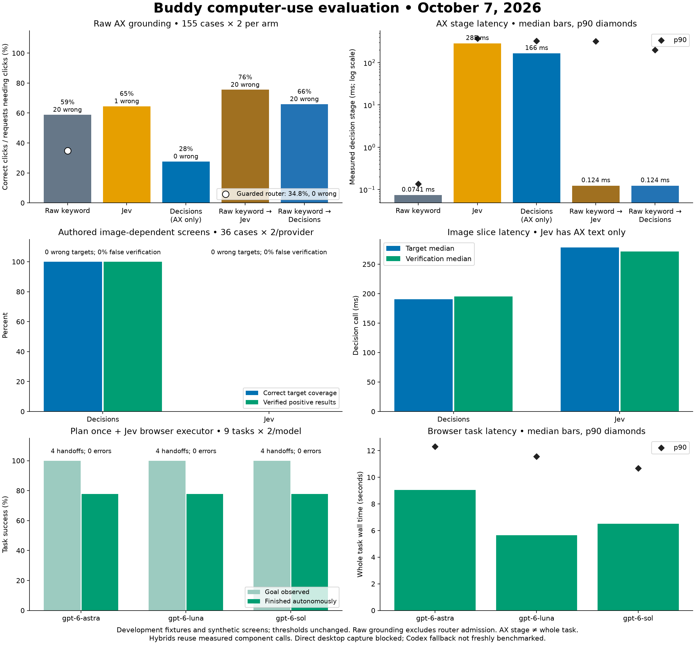

# Computer-use protocol evaluation, October 7, 2026

Decisions is strong when the answer requires the screenshot. Jev covers more labelled AX targets. The guarded keyword router remains the cheap first step. None of these stage results establishes a reliable autonomous Decisions desktop loop: the live Calculator trial did not verify a completion.

> **Later (2026-10-10):** the desk lane's judge moved to Gemma 4 26B + Jev on OpenRouter and was scored on a blind
> synthetic holdout: [visual judge verdict](evals/visual-judge-2026-10/VERDICT.md). It failed (Gemma's descriptions
> lowered Jev's coverage, and the latency and error gates failed), so it stays off.



## Scope and grading

- **AX grounding:** 155 existing cases in 13 recorded UI contexts across 9 apps, repeated twice for 310 requests per arm. Apps: Calendar, Finder, Mail, Music, Notes, Photos, Reminders, Safari, System Settings. All arms receive the same capped 25-control menus. These fixtures were already read during earlier development; this is a development suite, not an unread deployment holdout.
- **Image diagnostics:** 36 fixed authored cases repeated twice per provider: 24 target cases and 12 result checks. Layout ordering, two themes, three font sizes, missing targets and positive/negative results vary. Decisions gets the image and generic AX control labels; Jev gets those labels alone. This is a modality test, not a real UI execution comparison.
- **Browser tasks:** nine isolated local fixture tasks, twice each for three planner models, 54 actual runs. Each run uses eve’s real plan-once contract, Jev grounding and executor, with a fresh headless Chromium profile. Fixture state or specific answer patterns independently grade success. No account or real-world submission is involved.
- **Live desktop:** eight Calculator requests through the real Decisions route, using CUA capture/input because the daemon lacks Screen Recording permission. One real click produced 7; no result cleared the unchanged verification gate. See the [report](decisions-live-results.json) and [transport details](decisions-computer-use.md#visible-desktop-trial-october-7).
- **Not freshly measured:** the general Codex app-server fallback and the legacy repeated desktop planner. The comparison does not assign them invented speed or accuracy values. Direct daemon desktop execution remains blocked by Screen Recording permission.

AX latency measures the decision call or local picker, excluding AX capture, menu construction, input, settling, verification and fallback. Hybrid timing is derived from measured constituent calls, not a fresh end-to-end hybrid run. Browser timing measures the whole agent task after browser setup. Error calls remain in latency samples. Repetitions share cases and should not be treated as independent new task types. No thresholds were fitted on these results.

## AX target selection

| Grounding stage | Correct click coverage | Wrong choices | Precision when choosing | Median | p90 |
|---|---:|---:|---:|---:|---:|
| Keyword | 166/282 (58.9%) | 20 | 89.2% | 0.0741 ms | 0.136 ms |
| Jev | 182/282 (64.5%) | 1 | 99.5% | 285 ms | 373 ms |
| Decisions (AX only) | 78/282 (27.7%) | 0 | 100.0% | 166 ms | 326 ms |
| Keyword → Jev | 213/282 (75.5%) | 20 | 91.4% | 0.124 ms | 323 ms |
| Keyword → Decisions | 186/282 (66.0%) | 20 | 90.3% | 0.124 ms | 199 ms |

The raw keyword stage bypasses the router’s full-request coverage, question, app, dialog and safety admission checks. Its wrong choices are not deployed router clicks. The **actual guarded router** admitted 49/141 click cases (34.8%), with 0 wrong choices and 0 sensitive choices, in a separate 155-case fixture admission check. Recording effectors and a mocked post-click change signal mean this establishes admission behaviour only, not real action delivery or verification.

Jev’s one wrong choice was “change the desktop and dock appearance”: it chose Desktop & Dock while the fixture expects Appearance. Decisions selected 78 correct targets and declined the rest. Its stricter risk and coverage predicates intentionally reduce admission, so the coverage gap is not a like-for-like model accuracy estimate under identical policy thresholds.

The AX-only Decisions slice retained **four HTTP 400 responses**, all on two dialog cases repeated twice with an empty offered menu. The comparison harness attempted a choice containing only none. Production’s Decisions route exits before that call when no candidates exist or a dialog is open. These are retained harness/API validation failures, not successful refusals or evidence of a production click.

## Image-dependent diagnostics

| Provider | Correct present targets | Wrong targets | Absent-target abstentions | Correct verification | Median target / verify |
|---|---:|---:|---:|---:|---:|
| Decisions | 36/36 | 0 | 12/12 | 24/24 | 191 / 195 ms |
| Jev (text only) | 0/36 | 0 | 12/12 | 12/24 | 278 / 272 ms |

Jev abstained on every target and returned false for every result check. It therefore got negative checks right and missed positive ones; this is not evidence that it made wrong clicks. Decisions had no false-positive verification on this authored slice. The narrow templates and reused vocabulary limit generalization.

## Whole browser tasks (retained baseline)

| Planner + same Jev executor | Goal observed | Autonomous success | Handoffs | Median | p90 |
|---|---:|---:|---:|---:|---:|
| gpt-6-astra | 18/18 | 14/18 | 4 | 9.06 s | 12.32 s |
| gpt-6-luna | 18/18 | 14/18 | 4 | 5.64 s | 11.57 s |
| gpt-6-sol | 18/18 | 14/18 | 4 | 6.52 s | 10.68 s |

All three models reached every fixture goal, but the executor handed off after search-result navigation and cookie-banner handling in both repetitions. Calling those finished would overstate autonomous success. No browser harness or planner API errors were recorded. Luna had the fastest median; Sol had the lowest p90. These three rows compare planner models within one browser protocol, not three different computer-use protocols.

The nine tasks exercise a contact form, filtering and cart selection, search then link, a near-duplicate table row, settings behind a tab with save, a cookie banner, a target below the fold, a reservation form and reading after navigation.

## Implication for eve

Keep the guarded keyword router first. Jev remains useful for labelled AX/DOM grounding. Decisions is a promising additional lane where pixels supply the missing label or state, with conservative code admission and a handoff on failed verification. Keep Decisions opt-in until real unseen desktop tasks complete reliably. The next protocol improvement should address target-bound capture, animated overlays and evidence of task completion, rather than loosening thresholds to make a graph greener. The later swarm review traced browser search/cookie handoffs to plans expecting link names in generic destination titles/text. Observed destination metadata and an exact URL predicate address that mismatch; see the [fresh swarm comparison](computer-swarm-improvements.md).

## Evidence and reproduction

- [Raw paired AX responses](computer-protocol-eval/ax.json)
- [Raw visual responses and input image paths](computer-protocol-eval/visual.json)
- [Recomputed summaries and source hashes](computer-protocol-eval/summary.json)
- Browser JSONL and per-task agent traces: `docs/computer-protocol-eval/browser/`.
- [Evaluation acceptance ledger](computer-protocol-eval-gates.md)
- [Downloadable SVG](computer-protocol-eval/comparison.svg)

From the repository root (new evaluations call paid providers):

```sh
bridge/.venv/bin/python bridge/tools/computer_protocol_eval.py --out /tmp/eve-eval/ax.json
bridge/.venv/bin/python bridge/tools/computer_visual_eval.py --out /tmp/eve-eval/visual.json
bridge/.venv/bin/python bridge/tools/browser_model_eval.py run --models gpt-6-astra,gpt-6-sol,gpt-6-luna --tasks contact_form,shop_filter_cart,search_then_link,table_read,settings_tab_toggle,cookie_banner,below_the_fold,reservation_form,help_read_after_nav --repeats 2 --out-dir /tmp/eve-eval/browser
bridge/.venv/bin/python bridge/tools/computer_protocol_plot.py /tmp/eve-eval
```

Plotting additionally needs matplotlib: `uv pip install --python bridge/.venv/bin/python matplotlib` (installed in the local bridge venv for this evaluation). All source and result files remain local; nothing was pushed.

The [fresh swarm results](computer-swarm-improvements.md) preserve this baseline and report improved completion, guarded admission and unchanged limitations separately.
