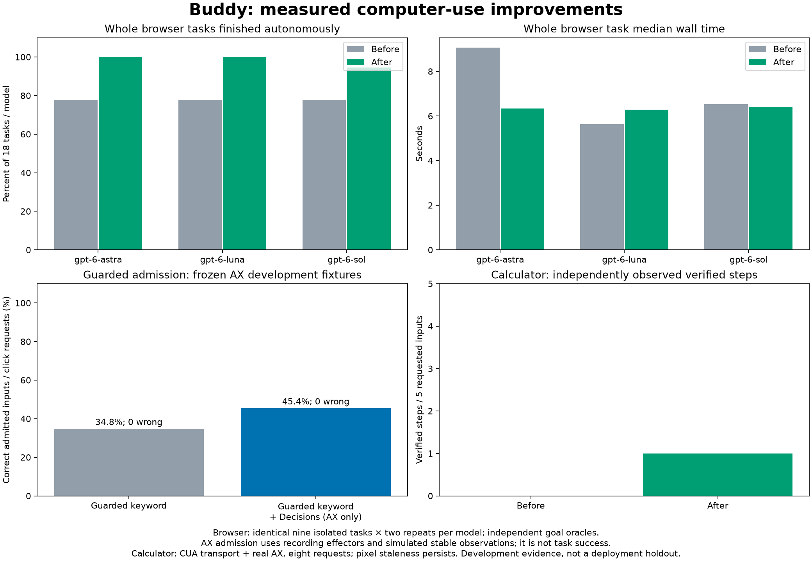

# Computer-use improvements from the evaluation swarm

The three-agent swarm improved observed browser completion from **42/54 to 53/54** on the same nine local tasks, twice for each of three models. All 54 fixture goals were reached in both cohorts. The browser planner now receives observed link destinations and verifies an exact destination URL against a fresh snapshot. The fixtures, independent goal oracles and probability thresholds were preserved. SVG export whitespace was normalized for patch hygiene; baseline raw reports and graph geometry/pixels were preserved.



| Browser planner | Autonomous before → after | Median task time before → after |
|---|---:|---:|
| gpt-6-astra | 14/18 → 18/18 | 9.06 s → 6.33 s |
| gpt-6-luna | 14/18 → 18/18 | 5.64 s → 6.29 s |
| gpt-6-sol | 14/18 → 17/18 | 6.52 s → 6.40 s |

This is a reliability improvement, not a universal speedup: Luna's median increased in the fresh batch. Network and model variation remain, and these repeated development fixtures are not a deployment holdout. Luna had the lowest fresh median and the lowest estimated planner cost in the harness. The daemon's browser planner now defaults to `gpt-6-luna`; `EVE_BROWSER_MODEL` overrides it. An explicit `EVE_AGENT_MODEL` or custom agent configuration is retained otherwise. Desktop defaults and budgets are preserved.

## Browser observations and verification

The earlier search/cookie handoffs were failed criteria: destination fixtures had generic titles/text while plans expected the link's recipe or article name. They were not evidence that the original executor reused stale observations. The outline now supplies full observed http(s) origin/path destinations for visible labelled links. Query, fragment and credential-bearing destinations are omitted rather than stripped into misleading criteria. Host-only site context remains available for query/fragment pages.

A new `url_is` predicate compares scheme, host, effective port, path, query and fragment exactly. It reads the URL from the latest successful snapshot; missing or failed observations fail closed. It never substitutes for a failed title/text predicate. Known Chromium execution-context navigation races receive bounded observation retries, with no extra action or cached success. Wrong destination and no-navigation controls are exercised against real Chromium.

The remaining Sol handoff expected `Changes saved`; the unchanged settings fixture showed `Saved`. The actual save occurred, but that expectation failed and stayed a handoff. One route-listener warning (`Fetch response has been disposed`) occurred as a fixture context closed; no recorded task/API error or lost fixture goal resulted.

## Guarded admission and Decisions evidence

Fresh AX evaluation contains **155 cases × two repeats × seven arms**. Raw keyword comparisons still retain their 20 wrong selections. Actual guarded keyword admission accepted 98/282 required inputs (34.8%); guarded keyword plus Decisions accepted 128/282 (45.4%), with zero wrong admissions in either arm. That adds 30 correct admissions. The fallback makes its own model call against the actual filtered menu, rather than reusing a raw answer from another menu.

These admission trials use frozen observations, simulated focus/image equality and recording effectors. Verification is forced false locally. They establish admission coverage, never completed desktop tasks. Median admission was 0.327 ms versus 0.789 ms; fallback p90 was 194.7 ms. The median model time is zero because many requests do not call a model. OS capture/input/settling time is excluded. Empty menus now abstain locally; fresh provider errors were zero.

Truncated accessibility trees now stop the keyword lane before action. An incomplete post-action observation preserves the applied input while declining completion. Fresh nonsecure readonly AX display values reach Decisions verification without changing archived fixture schemas. Freshness checks compare those readings. Secure text and editable values stay excluded from the text channel; numeric diagnostics identify stale pixels, changed AX state and verification scores.

The same authored image slice was rerun: 36 cases × two repeats × two providers, 144 responses. Decisions correctly selected all 36 present targets, abstained on all 12 absent-target trials and graded all 24 before/after cases. Text-only Jev abstained on all targets and graded 12/24 verification cases. These are modality diagnostics on authored screens, not real application execution.

## Actual Calculator rerun

The same eight-request sequence now verified the first click, `0 → 7`, at probability **0.99**, versus an observed but unverified click previously. Four following action requests still failed or abstained; three stopped because screenshot pixels changed. The question, typing and Safari requests handed off without input. The full arithmetic sequence did not complete.

Direct daemon capture remains blocked by macOS Screen Recording permission. This trial used permitted CUA capture/input plus real AX, bound to Calculator; the harness records that its bound target PID replaces global frontmost PID. It is one app and dependent sequential requests, with no desktop speed claim. Decisions remains opt-in; its thresholds and capture permissions were not relaxed.

## Evidence and reproduction

- [Complete protocol graph](computer-swarm/results/comparison.png), [guarded admission graph](computer-swarm/results/admission.png), [before/after summary](computer-swarm/results/improvement-summary.json).
- Fresh raw data: [AX](computer-swarm/results/ax.json), [image cases](computer-swarm/results/visual.json), [browser report and traces](computer-swarm/results/browser/report.json), [Calculator](computer-swarm/results/desktop.json).
- [Retained baseline](computer-protocol-evaluation.md), [browser findings](computer-swarm/browser-findings.md), [Decisions findings](computer-swarm/decisions-findings.md), [evaluation findings](computer-swarm/evaluation-findings.md), [engineering gates](computer-swarm-gates.md).

Run from the repo root. Provider runs incur API usage; fresh results should use a new directory to preserve prior evidence. The original browser fixture harness and tasks remain unchanged.

```sh
bridge/.venv/bin/python bridge/tools/computer_protocol_eval.py --out /tmp/eve-fresh/ax.json
bridge/.venv/bin/python bridge/tools/computer_visual_eval.py --out /tmp/eve-fresh/visual.json
bridge/.venv/bin/python bridge/tools/browser_model_eval.py run --models gpt-6-astra,gpt-6-sol,gpt-6-luna --tasks contact_form,shop_filter_cart,search_then_link,table_read,settings_tab_toggle,cookie_banner,below_the_fold,reservation_form,help_read_after_nav --repeats 2 --out-dir /tmp/eve-fresh/browser
bridge/.venv/bin/python bridge/tools/computer_protocol_plot.py /tmp/eve-fresh
```

Validate the retained fresh evidence without paid calls:

```sh
bridge/.venv/bin/python bridge/tools/computer_swarm_verify.py --browser docs/computer-swarm/results/browser
bridge/.venv/bin/python bridge/tools/computer_swarm_verify.py --evidence docs/computer-swarm/results
bridge/.venv/bin/python bridge/tools/computer_protocol_plot.py --check docs/computer-swarm/results
```

The checkers reconstruct fixture goal/target oracles and gating from raw observations/answers, reject mismatched menus or missing paired cases, and regenerate plot pixels to reject stale graphs. General Codex fallback and legacy turn-by-turn desktop planning remain unbenchmarked in this cohort.
