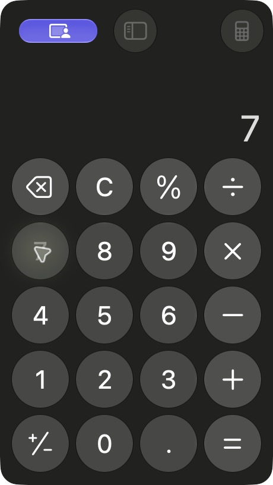

# Image-aware Decisions before Codex

`EVE_DECISIONS=1` adds a bounded visual click loop after the desk lane's
keyword router declines a request with zero input. It uses OpenAI's beta
`POST /v1/decisions`, with `gpt-6-luna` by default. The ordinary keyword path
still finishes its measured simple requests without a model call.

## Off in the daemon since 2026-10-08

Eve now calls every model through `OPENROUTER_API_KEY`
([one key: OpenRouter](openrouter.md)). OpenRouter has no Decisions API, so the
daemon no longer builds this client. `EVE_DECISIONS=1` logs one line saying
the judge is off, and the desk lane sends what its keyword clicks miss to Codex.
Jev, on OpenRouter, takes a text state and choice questions, not screenshots
with predicate questions, so moving the judge to Jev would mean writing a new
safety judgement. The development tools below (`tools/decisions_eval.py`,
`tools/decisions_live_demo.py`) still call OpenAI's Decisions beta with an
`OPENAI_API_KEY` of their own.

## Enable it (before 2026-10-08)

These settings in `~/.config/eve-bridge/env` turned it on before the change:

```text
EVE_DESK_LANE=1
EVE_DECISIONS=1
OPENAI_API_KEY=<your existing OpenAI API key>
```

`EVE_DECISIONS_MODEL` overrides the default model. The endpoint must support
that model. Missing credentials, endpoint errors, refusals and malformed answers
leave the request to Codex. Set `EVE_DECISIONS=0` to disable it. It ships off:
the live checks below are synthetic diagnostics, not a deployment holdout.

## The loop

1. Observe the frontmost window's Accessibility tree and a detached screen image
   in screen points. Images are bounded to 1600 pixels on their longest side for
   transport, with the original dimensions supplied alongside the control rectangles.
2. Offer up to 25 enabled, labelled controls from the existing fast lane's menu.
   One API request asks for a target choice, whether a suitable control is present,
   whether one click covers the whole step, and whether the step is consequential.
3. Require target probability and confidence at least 0.95, margin at least 0.5,
   presence and coverage at least 0.95, and risk at most 0.05. These are conservative
   experimental cut-offs; they have not been calibrated on unseen desktop tasks.
4. Reobserve both tree and pixels. Changed controls, values, window title, process,
   dialogs, truncation or pixels below the menu bar invalidate the pending decision.
   Click through the existing live hit-test and AXPress fallback, using the freshly
   observed control. The model cannot invent coordinates or execute code.
5. Settle, observe again, and send before/after evidence to a separate verification
   predicate. Require 0.95 that the entire requested step is visibly satisfied.
   Screen change or focus alone is insufficient. A selected control can satisfy its
   step without a click after selection and freshness checks pass.

Requests are limited to four explicitly worded clauses and ten meaningful words.
Questions, typing, consequential requests, another installed app, System Settings,
dialogs and truncated snapshots stay with Codex. Sensitive and secure controls
retain the existing code filters. Each control may be attempted once per route.
An effector or capture exception after a possibly delivered click preserves that
click in a `partial` result. The existing Codex handoff lists the attempted controls
and tells it to inspect the screen before doing anything again.

This first loop grounds existing labelled Accessibility controls. Vision helps
interpret those controls and verify their effect. An unlabelled canvas with no
observed actionable controls still needs Codex. It does not generate a plan for
arbitrary tasks. Animated screens may invalidate its strict freshness check.

The daemon serializes this lane with its existing desk-lane lock. Its existing
cancellation check runs after the lane returns; this change does not add interruption
of a model request or of the worker thread while a route is executing.

## Data and usage

When enabled for a request, the step, app name, control labels/rectangles and
screenshots leave the Mac for OpenAI. The text evidence excludes secure controls
and arbitrary field values; the screenshot can still show whatever is visible.
Fresh nonsecure readonly AX display values also reach the verifier; editable values
and secure descendants are excluded from this text channel. Freshness compares those
readings and context. Screenshots and request bodies are not written to the route log.
Only timings, bounded numeric gate scores and redacted failure reasons are logged. The HTTP client reuses its connection,
has a three-second timeout per request, and does not retry a decision.

Every answered request records its usage under `computer_decisions` in the existing
spend ledger, even if parsing subsequently rejects its answer. These entries are
unpriced until Decisions-specific billing is verified; ordinary Responses prices
are not silently applied to the beta endpoint.

## Evidence, 2026-10-07

The read-only comparison calls both live services with authored calendar toolbar
screens. Six target cases include three whose Accessibility labels conceal the
visible view names; four verification cases include both satisfied and unsatisfied
outcomes with and without useful text state. It performs no mouse or keyboard input.

| Measured result | Decisions | Jev |
|---|---:|---:|
| Gated correct target choices | 6/6 | 3/6 |
| Correct result verifications | 4/4 | 2/4 |
| Target request median | 190 ms | 283 ms |
| Verification request median | 198 ms | 296 ms |
| Target input tokens across six cases | 7,656 | 5,298 |
| Verification input tokens across four cases | 3,612 | 1,400 |

These are API-request timings, not total computer-task latency. Decisions receives
images; Jev receives the available text. The sample is small and deliberately
exercises image-dependent cases. It establishes working image input and a useful
diagnostic signal, not a general accuracy, cost or real-desktop speedup claim.

The [initial run](decisions-eval-initial.json) chose plausible target IDs but admitted
zero clicks: its predicates conflated view navigation with a persistent setting
change and included unrelated policy statements. Predicate wording was made atomic
and the distinction explicit, then the same cases were rerun. The table is that
[second tuning run](decisions-eval.json), not an unread evaluation set. No thresholds
were relaxed to obtain it.

Reproduce from the repo root (paid API calls, synthetic evidence only):

```sh
bridge/.venv/bin/python bridge/tools/decisions_eval.py --live --out /tmp/decisions-eval.json
```

The adapter, desktop wiring, stale-state admission, bounded execution, failure
handoffs, repeat protection and verification have deterministic tests; the
[task ledger](decisions-gates.md) records their executed checks. This feature remains opt-in.

## Visible desktop trial, October 7

The [live report](decisions-live-results.json) records eight actual Calculator requests.
The Decisions route chose and clicked 7; Calculator visibly showed 7, but the model's
verification did not reach the unchanged 0.95 threshold. Four following action requests
abstained or stopped at screenshot revalidation. The question, typing request and
request to open Safari handed off without input. There were **zero autonomously verified
completions**, one observed but unverified result, and three safe handoffs. Later
requests depended on the earlier calculation state, so this sequence is diagnostic,
not eight independent accuracy trials.



The Python daemon's own capture failed because macOS Screen Recording permission was
not granted. The demonstration used Codex's permitted CUA app connection for capture
and input around the real Decisions route and real AX walker. Images and rectangles
were expressed in Calculator window points. The target-bound app PID replaced the
global foreground PID for this transport only. The production adapter was not changed.

The [first attempt](decisions-live-initial.json) made no clicks because its global
foreground observation saw Codex. The [next attempt](decisions-live-stale.json) made
no clicks because CUA's animated pointer changed screenshot pixels. The final trial
placed the pointer in the top strip and used the production-style 32-point exclusion;
later pointer motion still caused stale-observation refusals. These failures are retained.
No policy or probability threshold was lowered. The [demo ledger](decisions-live-gates.md)
and harness document the evidence and transport differences.

See the [extensive protocol comparison](computer-protocol-evaluation.md) for separately
measured AX grounding, image-dependent diagnostics and whole browser tasks. An image
classification advantage alone does not establish an autonomous desktop speedup.

Official wire reference: [Create a decision](https://developers.openai.com/api/reference/resources/decisions/methods/create).

## Swarm rerun

The [fresh eight-request Calculator report](computer-swarm/results/desktop.json) now
verifies the first click, `0 → 7`, at 0.99. Four later inputs still fail or abstain,
including three pixel-staleness handoffs; three planner-only requests hand off safely.
The whole arithmetic sequence remains incomplete. Readonly AX result evidence improved
verification while the 0.95 threshold and capture permissions stayed unchanged.
See [before/after graphs and the full evaluation](computer-swarm-improvements.md).
