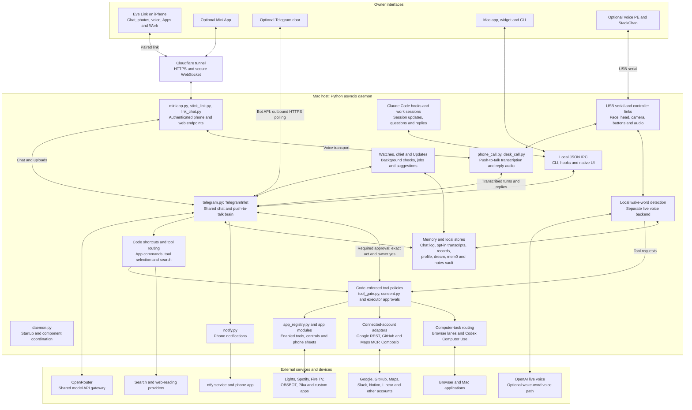
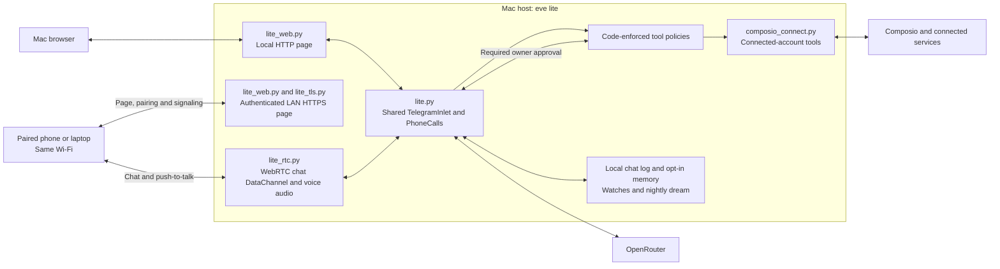

# System design

eve runs on a Mac. Eve Link and the optional desk devices are interfaces to that
host; the iPhone does not run the brain. The diagrams show logical components and
their main connections, rather than every module or optional integration.

## Full eve

`daemon.py` builds and connects the host components. Telegram transport is optional:
`EVE_TELEGRAM=app` retains `TelegramInlet` for Eve Link, calls and background jobs
without sending messages to Telegram. Voice PE presses record the Mac microphone;
Eve Link records the phone microphone. Wake-word voice uses a separate live backend.

The tool-policy box represents several code checks, including connected-account
policies and final approvals inside individual executors. Reads and routine
reversible work can proceed; consequential actions require the owner's approval.
When a turn has read outside content, the approval question must show the complete
act. A model's proposed action does not grant consent. Computer tasks also relay
their own permissions, progress and cancellation through eve.

OpenRouter supplies the shared model calls. The separate live voice connection and
Codex's own sign-in or optional API billing are distinct paths. Device adapters use
their own protocols: LAN, BLE, USB, service APIs or MCP. Pika can stream video from
the Mac directly to the phone over WebRTC, with the tunnel as fallback; that media
path is omitted above for clarity. Storage is on the Mac, but model requests and
enabled external integrations send the relevant inputs to their providers.

## eve lite

eve lite is an alternative deployment selected by `EVE_PROFILE=lite`. It starts
`lite.py` instead of the full daemon and reuses the shared chat, call, memory and
tool-policy components. It does not start the full deployment's device links,
desktop automation or coding sessions.

The lite phone path stays on the local network and does not need the full
deployment's Cloudflare tunnel or native iPhone app. Composio sign-in is optional;
OpenRouter sign-in enables the brain.

## Implementation guides

- [Repository overview and component table](../README.md#how-it-works)
- [Eve Link pairing and Action Button](action-button.md), [chat](app-chat.md) and [voice mode](voice-mode.md)
- [App registry and adding an app](adding-an-app.md)
- [Connected accounts and their policies](apps.md)
- [Computer-task routing](stackchan/routing.md) and [Codex integration](codex-computer-use/README.md)
- [Conversation memory](stackchan/memory.md) and [chief's job lifecycle](stackchan/chief.md)
- [eve lite deployment](lite.md) and [verified state machines](verification.md)
