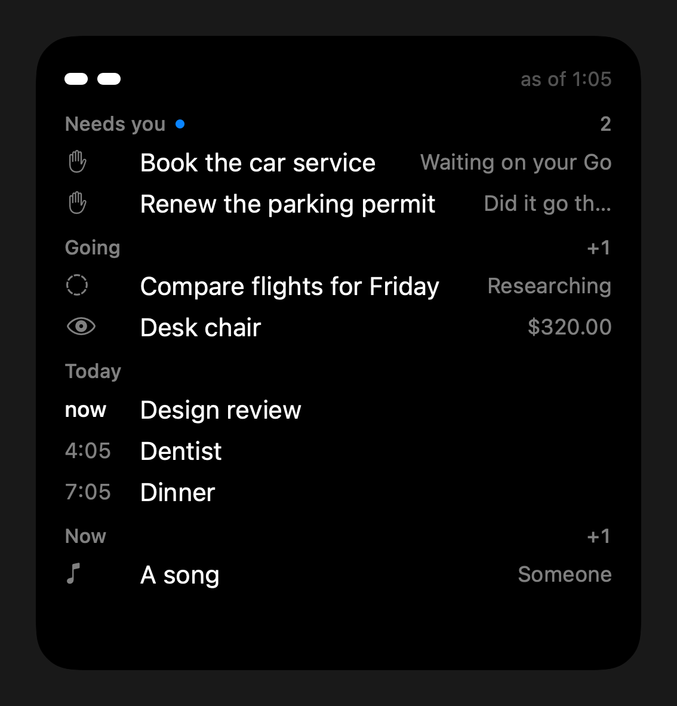
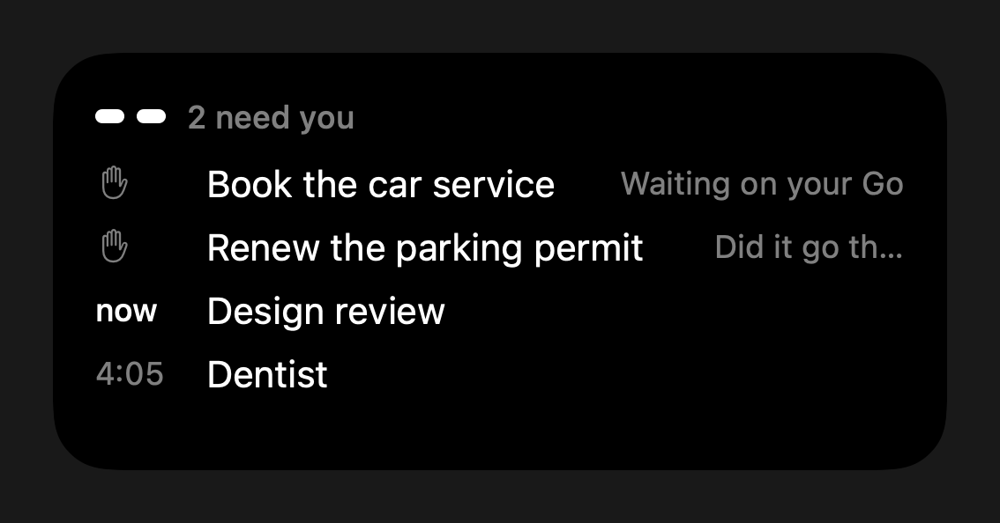

# Eve Link's home-screen widget

On 2026-10-08 the owner asked for "an eve widget for my phone that just tracks
everything i have to do/have going, like a command center type dashboard
large". The same day's design rule applies: minimal, white on black, eve's
two white pill eyes as the only mark, plain SF Symbols, one line per row, and
no colour unless it carries meaning.





The pictures use made-up sample data (`TodaySample` in
`ios/EveLink/Controls/TodayWidget.swift`). They were drawn on the Mac with
`ImageRenderer`, not taken from a phone. The large one shows old data, so it
has the quiet "as of" time at the top right.

## What it shows

Add **eve** from the widget gallery. It comes in two sizes:

- **Large** is the command center. It has up to four sections, in this order.
  A section shows only when it has something in it.
  - **Needs you**: first, what you must sign in to again, with a key: Google
    refused its sign-in, or the Google sign-in or the app's 7-day install
    lapses within 36 hours ([refresh](refresh.md#on-the-widget)). Then the
    chief's jobs that wait on the owner (a Go, an answer, a budget raise, a
    receipt not confirmed, or an act that may already have happened). The
    heading has the app's blue dot and the full count.
  - **Going**: the chief's other open jobs, then the watches that are on
    (prices, quotes, tickets: the label and the latest reading). A paused
    watch is left out. A watch that eve cannot read says "can't read it".
  - **Today**: the calendar events left today, from your own Google calendar
    and your work calendars connected through Composio, in one list. All-day
    events come first. An event on both calendars shows once.
    Each event row starts with its time, or "now" while it is under way.
    Declined and cancelled events are left out.
  - **Now**: the Spotify track playing, and the TV's app while the TV is on.

  When everything does not fit (12 lines, a heading counts as one), each
  section keeps its heading and first row. The rest of the room goes first to
  Needs you, then Today, then Going, then Now. A section that was cut short
  shows "+N" for the rows it left out.
- **Medium** shows the top four rows, with no headings, in the same priority
  order. "2 need you" sits next to the eyes.

When there is nothing, the widget shows one line: "Nothing on. eve's
watching."

A tap anywhere opens Eve Link on the **Work** view (`evelink://work`).

## Where the data comes from

The widget makes one read: `GET /api/link/today` on the daemon. It uses the
same tunnel and the same link token (`Authorization: Bearer`) as the rest of
the app. Any `Origin` header is refused, as on every other `/api/link` path.
The daemon side is `bridge/src/eve_bridge/link_today.py`, and it only
reads.

| Source | What the daemon reads | Off when |
|---|---|---|
| `jobs` | the chief's open cards (`link_chat.list_jobs`) | the chief is off |
| `watches` | `watch.Watcher.watches` | the watcher is off |
| `calendar` | `calendar__list_events` from now to midnight, through the direct Google apps (`apps_mcp.AppsBridge`) | the calendar is not signed in |
| `work_calendar` | `GOOGLECALENDAR_EVENTS_LIST` from now to midnight, through Composio, for each calendar account aliased other than `personal` (the accounts [Updates](updates.md) reads) | Composio is off, `EVE_UPDATES_COMPOSIO=0`, or no work calendar is connected |
| `music` | the Mini App's Music card, `{"action": "status"}` | no Spotify login |
| `tv` | the Mini App's TV remote, `{"action": "status"}` | no TV |

The answer:

```json
{"at": 1760000000.0, "needs_you": 2,
 "needs": [{"id": "c4", "kind": "job", "title": "...", "line": "Waiting on your Go"}],
 "going": [{"id": "c5", "kind": "job", "title": "...", "line": "Researching"},
           {"id": "w1", "kind": "watch", "title": "...", "line": "$320.00"}],
 "today": [{"title": "...", "start": 1760000000.0, "end": 1760003600.0, "all_day": false, "place": "..."}],
 "now": [{"kind": "music", "title": "...", "line": "..."}, {"kind": "tv", "title": "TV", "line": "YouTube"}],
 "sources": {"jobs": "ok", "watches": "ok", "calendar": "ok", "work_calendar": "ok", "music": "off",
             "tv": "failed"}}
```

The daemon reads every source at the same time, and each source has its own
time limit: 4 s, 8 s for the calendar, which makes one request per
calendar, and 10 s for the work calendars. A source that is off, slow or broken is left out of the lists and
is named in `sources` as `"off"` or `"failed"`. It never fails the whole
answer. A calendar read that takes too long still finishes in the background.
Its result is used on the next refresh. The daemon keeps each calendar answer for
5 minutes, so frequent refreshes do not each call Google. The log has counts
only, never titles.

## Refresh

- The widget reads every 15 minutes. It also redraws at each event's start and
  end inside that window, so "now" and the list of events stay correct between
  reads.
- After a read that could not reach the Mac, it tries again in 2 minutes, not
  15. A restart of eve takes about 30 s to post its new tunnel address, and a
  read in that gap used to leave "Can't reach the Mac." up for 15 minutes.
- The app asks WidgetKit for a fresh read when it comes to the front, when it
  pairs, and when the Work view's jobs change (a job came, went, or moved).
  WidgetKit decides when the read actually runs.

## When the Mac does not answer

- **Not paired**: one line, "Open Eve Link to pair."
- **The Mac or the tunnel is away**: the widget asks the rendezvous for
  eve's new address (as the app does) and tries once more there. If the new
  address works, the widget saves it. If that try also fails, the widget shows
  the last good answer with a quiet "as of 5:42" at the top right. With no
  earlier answer, it shows one line: "Can't reach the Mac."
- **An older eve without `/api/link/today`** (404): "Update eve on the
  Mac." The last good data shows if there is any.
- **The token was refused** (401): "Pair Eve Link again."

The last good answer is kept in the widget extension's own container
(`Application Support/EveLinkToday.json`). Only the widget reads it.

## The pairing: a shared Keychain group

The app keeps the pairing (eve's address and the link token) in the
Keychain. A widget extension cannot read the app's own Keychain items. Both
targets therefore list one more Keychain access group,
`$(AppIdentifierPrefix)com.github.eve-bridge.EveLink.shared`. The
groups are set in `project.yml`, which writes `App/EveLink.entitlements` and
`Controls/EveLinkControls.entitlements`. Each target's Info.plist carries the
group's full name as `EveKeychainGroup` (`Shared/Pairing.swift`).

- A new pairing is saved in that group.
- When the app launches and finds a pairing from before the widget existed, it
  copies the pairing into the group once (`Keychain.share`).
- A build signed without the entitlement keeps the pairing where only the app
  can read it, as before. The widget then says "Open Eve Link to pair."

The token stays in the Keychain. It is never written to a shared file. This is
a Keychain access group under the same team, not an App Group, so no new
capability needs to be registered for the App ID. `build.sh` signs
automatically (`-allowProvisioningUpdates`), and the next build signs the new
entitlement. Reinstall after that build.

## Files

- `bridge/src/eve_bridge/link_today.py`: the daemon's read. It is wired
  into `link_chat.LinkChat.serve` as `TODAY_PATH`.
- `ios/EveLink/Shared/Today.swift`: decoding, the cache, the fallback, and
  which rows fit. It uses Foundation only.
- `ios/EveLink/Shared/Pairing.swift`: the pairing and its Keychain item. Both
  targets use it.
- `ios/EveLink/Controls/TodayWidget.swift`: the provider and the views. It is
  in the `EveLinkControls` bundle beside the Talk control and the call's Live
  Activity.

## Tests

- `bridge/tests/test_link_today.py`: the link token, any Origin refused, GET
  only; each source gathered and shaped; open jobs that do not need the owner
  listed as going; nothing on as an empty answer; a calendar that is not signed
  in reported as off; the work calendar merged in, read once per 5 minutes,
  and off when none is connected; a slow or broken source left out while the rest still
  come; and a slow calendar read kept for the next refresh.
- `sh ios/EveLink/Tests/run.sh` (`TODAY_OK`): the decoding, events that
  ended dropped, the section budget and its priority, the medium rows, the
  `evelink://work` route, and the fallback. The fallback cases are: unpaired,
  a good answer kept, a dead tunnel moved through the rendezvous, the last good
  data with its time, an older eve, and a refused token.

## Left out

- No small size, and no Lock Screen widgets. Large and medium only.
- The widget does not act. A tap opens Work, where the Go and the other
  actions are.
- No mail, no reminders, and no notes from the owner's vault. The widget shows
  only what the daemon already tracks.
